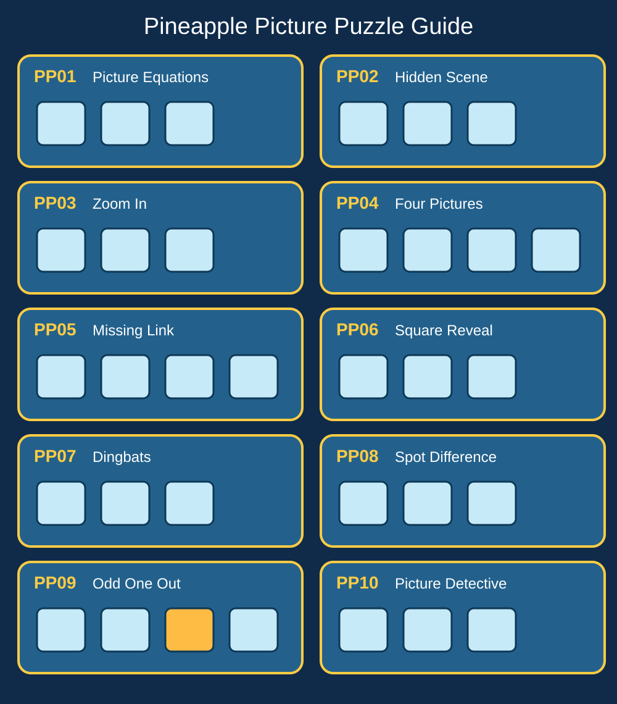

# 🍍 PINEAPPLE GAME RULES & HOST GUIDE

**Last compiled:** 12 October 2026  
**Purpose:** One reference for running Pineapple Telegram games and Pineapple Lounge website-assisted games. Organised by day, then special events and any-day games.

**Status key:** ✅ Established = rules or workflow previously agreed/used. 🟡 Basic format = game concept agreed but details may vary. 💡 Developing = proposed; don't treat suggested rules as already approved.

**General hosting guidance:** Keep instructions short; allow late participation when practical; use polls, short guesses and picture clues where possible. Avoid inventing scores or claiming a winner without recorded results. For member-centred games, keep participation voluntary and jokes good-natured.

---

## 🕵️ MONDAY

### Mystery Monday — ✅ Established umbrella format
**Aim:** Identify a hidden person, object, location or other mystery.

**Two regular formats:**
1. **Square Reveal:** Post a concealed picture. Uncover squares progressively as members guess; reveal the full picture at the end.
2. **Clue Reveal:** Post a difficult clue, then progressively easier clues until the answer is found or revealed.

**Variants:** Mystery Member, Mystery Celebrity, Who Am I?, Mystery Object and Mystery Location. **Occasional special:** fictional Murder Mystery (see Special Events).

**Hosting notes:** Announce the category when useful; accept guesses in chat; avoid giving away the answer before the planned reveal. Exact number of squares, clue intervals, point scoring and tie-breaks are not fixed in the available rules.

**Self-running Celebrity Clue Scene (new):** Post one SFW image with **five indirect clues about the real celebrity** (two hard, two medium, one easier). Members guess the **person, not a character**, and explain at least three clues. No obvious programme titles, character names, signatures or answer labels; keep the key separate. No timed host interventions required. **History and test images:** [Mystery Monday Celebrity Register](PINEAPPLE_MYSTERY_MONDAY_HISTORY.md) — includes previous celebrities plus Johnny Depp, Angelina Jolie and Rowan Atkinson (new images created, not confirmed played).

### Wrong ’Un Monday — 🟡 Basic format
Post a question or scenario inviting deliberately wrong, mischievous or ridiculous answers. Members reply in chat. Humour rather than factual correctness is the point. No established scoring.

### Monday Mayhem — 🟡 Basic format
Use a wheel or randomiser to select surprise mini-games and challenges. Explain each selected round before play. No fixed round count or points system.

### Monday alternatives — 💡 Developing
**Majority Monday:** Guess the most common survey answer. **Magnify Monday:** Identify a close-up. **Make It Up Monday:** Spot the lie. **Missing Link Monday:** Find the connection between pictures. These are weekday names for the reusable game formats below, not four additional mandatory Monday events.

---

## 🧩 TUESDAY

### Teaser Tuesday — 🟡 Agreed format; newer game
Show picture puzzles or visual rebuses. Members guess the hidden film, TV show, song, celebrity, saying or general-knowledge answer in chat. A poster can contain several numbered puzzles. Reveal answers later. Five puzzles is a suggested starting format, **not a fixed rule**.

**Reusable poster:** Pineapple Puzzles. Related variants: Two Clues Tuesday, Wordplay Wednesday, Friday Five, Solve It Saturday, Sunday Brain Fry.

### Choo Choo Choose Tuesday — 🟡 Basic format
Post two options (A versus B). Members choose one, ideally using a Telegram poll, and can discuss their choice. No correct answer or fixed scoring unless announced for a particular edition.

### Tunes Tuesday — 🟡 Basic format
Guess songs, artists or music-related clues. Use short answers or polls. Exact rounds and scoring are not fixed.

### Telly Tuesday — 🟡 Revised format
Run games inspired by television game shows, adapted for Telegram polls, short answers and group challenges. This is broader than TV trivia alone. Announce the specific format before each edition.

### Tuesday alternatives — 💡 Developing
**Top Answer Tuesday:** Survey-answer prediction. **Tiny Detail Tuesday:** Zoom-in picture guessing. **Truth or Trash Tuesday:** Find the false statement. **Two Clues Tuesday:** Solve an answer from two images.

---

## 🌍 WEDNESDAY

### Where’s Scotty Wednesday — ✅ Established
Post a busy scene with Scotty hidden in it. Members try to find him and reply with a location or marked square as appropriate to that edition.

**Website versions:** 12-square and 20-square versions have been used/built. Don't assume a fixed grid size for every round.

### Where’s Scotty? Hot or Cold — ✅ Established and popular
A secret city/location is chosen. Members guess locations. The host/game gives **temperature-style proximity clues**, from freezing through warmer to boiling, based on how close the guess is to the hidden answer. Continue until the location is found or revealed.

**Hosting notes:** State the location category or geographic scope if needed. Do not invent precise distance thresholds or a points system; these are not fixed in the recorded rules.

### Wildcard Wednesday — 🟡 Basic format
Announce a surprise game on the day. The selected game supplies the rules.

### Wheel of Whatever Wednesday — 🟡 Basic format
Spin a wheel to choose the next challenge or mini-game; announce what the chosen segment means.

### Workshop Wednesday — 🟡 Basic format
A creative activity, such as photography, posing or editing, with member contributions. Participation is optional.

### Wednesday alternatives — 💡 Developing
**What Would They Say Wednesday?** Popular-answer guessing. **What’s That Wednesday?** Close-up identification. **Whopper Wednesday:** Two truths and a lie. **What’s the Link Wednesday?:** Picture/celebrity connections. **Wordplay Wednesday:** Rebus and dingbat puzzles.

---

## ✨ THURSDAY

### Transform Thursday — ✅ Established
Post a theme and invite members to share a funny AI photo transformation. A past theme was **what you wanted to be when you grew up**. Members share their results; this is a creative social game, with no required scoring.

### Throw the Dice Thursday — 🟡 Basic format
Assign six questions or challenges to numbers **1–6**. Members roll/select a number and respond to its prompt. Announce the six prompts for that edition.

### Truth or Dare Thursday — 🟡 Recognised rotating favourite
Members choose a truth question or a dare/challenge. Keep it voluntary, with a pass option and no pressure to share personal material. Exact selection mechanism is flexible; **Truth or Dare Roulette** is a proposed wheel-based variant.

### For F… Sake Thursday — 🟡 Basic format
Invite funny, relatable rants about everyday frustrations. Keep it playful; no scoring.

### Thursday alternatives — 💡 Developing
**Think Like Them Thursday:** Predict popular answers. **Take a Closer Look Thursday:** Magnified image. **Truth or Twaddle Thursday:** Spot a false statement. **Think It Thursday:** Visual brain teasers.

---

## 😂 FRIDAY

### Thank GIF It’s Friday — 🟡 Established social format
Post a situation, question or prompt. Members answer **with GIFs**. Can be rotated rather than run every week to avoid repetition.

### One Word Friday — 🟡 Basic format
Post a prompt. Each reply must be **one word**. No scoring required.

### Finish Line Friday — 🟡 Established game / website race
Run a virtual race and show finishing positions. Announce entrants and any winner rules for that specific race. Detailed race mechanics and points are not fully documented here.

### Friday alternatives — 💡 Developing
**Family Fortunes Friday:** Popular survey answers. **Focus Friday:** Zoom-in guessing. **Fibbing Friday:** Two truths and one lie. **Figure It Out Friday:** Picture puzzles. **Friday Five:** Five numbered puzzles on a poster.

---

## ⚔️ SATURDAY

### Showdown Saturday — ✅ Established: OPEN SHOWDOWN (current default)
**Objective:** Predict which answer will be most popular with the Pineapple group, not which answer is objectively right.

1. Host posts **10 A/B Telegram polls** for the event.
2. **All members can participate**, provided they complete the polls within their timers. This **Open Showdown** format supersedes the older tagged-head-to-head trial as the default.
3. Players choose their answers **directly in the Telegram polls**, not by private message.
4. Members can vote and discuss their choices. Results remain **hidden until the poll timer ends**.
5. For each question, a player scores for choosing the option that gets the most group votes; there are **no factual right/wrong answers**.
6. **Missed polls incur a point deduction** under the agreed Open Showdown approach. **The exact deduction amount is not verified in the available rules and must be checked before publishing a numeric score.**
7. Add up the event results and announce the winner(s). Ties can produce joint winners.

**History:** Week 1 official winner @Hawitslisa; Caz unofficial winner. Week 2 had seven joint winners (Alex, Billy, Coral, Jasmine, Kar, Kirsten, Scotty Middy). Historical scores belong in the separate results record, not in these rules.

**Earlier test format (not default):** Tagged members competed head-to-head over 10 polls while others could vote. Preserve only as an optional legacy variant.

### Sweepstake Saturday / Horse Racing — 🟡 Established event concept
Members choose or are assigned racers; a virtual race produces positions. Depending on the edition, races may have eliminations, a running leaderboard and a final. See Special Events for the known tournament approach. Exact allocation, point values and elimination thresholds should be announced for each event, not guessed.

### Snap It Saturday — 🟡 Basic format
Host posts a photo theme, subject or prop. Members share their own suitable photos. No scoring unless stated.

### Sell It Saturday — 🟡 Basic format; lower engagement
Members pitch an everyday or ridiculous item as though selling it. This required more creative effort and **did not perform as well**, so treat as an occasional experiment rather than a regular priority.

### Saturday alternatives — 💡 Developing
**Survey Says Saturday:** Guess survey responses. **Spot It Saturday:** Close-up details. **Spot the Porky Saturday:** Find the lie. **Solve It Saturday:** Picture puzzles.

---

## 💬 SUNDAY

### Say It Sunday — 🟡 Established, evolving format
A discussion or **finish/add-to-the-sentence** game. Host posts a prompt; members respond with short or funny answers.

**Example played:** “Bad things to say on a first date.” Dark humour emerged naturally in responses. A closing question or wrap-up can highlight the funniest responses. No established scoring.

### Sunday Roast — ✅ Established community rules
1. Feature **one consenting roastee** for the round.
2. Roast the **story or situation**, not personal vulnerabilities.
3. Replies can use **GIFs, memes and playful jokes**.
4. **PASS is always allowed**.
5. **Do not target insecurities** or sensitive personal issues.
6. The **roastee chooses the funniest roast**.

**Frequency:** Better as an occasional/monthly feature than a compulsory weekly game.

**Website tool:** A roast generator has been developed with mild/funny/spicy/flirty/Pineapple/savage/unhinged categories, plus a mixed Russian Roulette mode. Generated lines are prompts, **not permission to ignore the safety rules above**.

### Sunday alternatives — 💡 Developing
**Survey Says Sunday:** Predict popular answers. **Squinting Sunday:** Extreme close-ups. **Spot the Lie Sunday:** Two truths and one lie. **Sunday Brain Fry:** Visual riddles. **Sunday Connections:** Find the link between clues.

---

## 🏆 PINEAPPLE SPECIAL EVENTS

### Deal or No Deal — ✅ Played; mechanics partly documented
- Use the Pineapple Lounge **22-box** game.
- Boxes contain hidden values; a player keeps a chosen box.
- Other boxes are opened in rounds, and the **Banker makes offers**.
- Player decides whether to accept a deal or continue.
- Reveal the retained box at the end if playing through.

**Known history:** Played across at least two weeks; box **#17** was kept in week 2. Week 1 kept a different box, but its number is **not verified here**. Exact box values, opening schedule, Banker formula and prize arrangements must be taken from the actual game configuration rather than invented.

### Pineapple Horse Racing — ✅ Played; tournament specifics may vary
- Start with the **12 original named horses**.
- Run virtual races and record podiums and eliminations.
- Horses may be removed between rounds as the field narrows.
- Keep a running results record and announce the final champion.

**Original 12:** Only Fool and Horsey; Glue Factory Gal; Hung Like a Donkey; Giddy Up Pony; Dog Food Tomorrow; Neigh Chance; Smack the Pony; Midnight Rouge; Fifty Shades of Hay; Soggy Biscuit; My Little Pony; Who’s Horse Is That.

**Recorded champion:** Neigh Chance. The final podium was Neigh Chance, Hung Like a Donkey, Only Fool and Horsey. Do not derive a points formula or elimination order without consulting the results database.

### Pineapple Murder Mystery — 🟡 Special concept
A fictional whodunnit with clues released progressively. Consenting group members can appear as **fictional** suspects, witnesses or detectives. Members discuss clues and guess the culprit. No fixed script, number of suspects, reveal schedule or scoring has been agreed.

### Pineapple Chase — 💡 Developing
A quiz-show-inspired live group game intended for members in the UK participating at the same time. Full rounds, chaser mechanics, timers and scoring are **not yet agreed**.

### Wheel of Whatever / Showdown Championship — 💡 Developing
**Wheel of Whatever:** A special wheel-led sequence of random challenges. **Showdown Championship:** A larger tournament based on popular-choice polls. Announce format and scoring before use; neither has a final published rulebook yet.

---

## 🍍 PLAY ANY DAY — REUSABLE FORMATS

| Game | How to play | Status |
|---|---|---|
| 🔎 Zoom In! | Show a close-up; members guess the object, celebrity or location; reveal more of the image until solved | 🟡 |
| 🤥 Porky Pineapple | Present **three statements: two true, one false**. Members vote for the lie; reveal it | 🟡 |
| 📊 Pineapple Fortunes | Ask a survey-style question; members predict the **most popular answers**; reveal the ranking | 🟡 |
| 🔗 Pineapple Connections | Show pictures or clues sharing a hidden connection; members guess the link | 🟡 |
| 🧩 Pineapple Puzzles | Post numbered visual rebuses; members guess the hidden words or phrases | 🟡 |
| 💨 Pineapple Speed Chat | Host rapid short-answer questions; members respond in chat | 🟡 |
| 👑 Member Takeover | A volunteer member hosts prompts or activities | 🟡 |
| 🍍 Pass the Pineapple | One member passes a challenge or prompt to another; allow passing | 🟡 |
| 🎨 Pineapple Creative | Caption, photo or creative task announced by host | 🟡 |
| 🧠 Pineapple Pursuit | General-knowledge trivia questions | 🟡 |
| 💬 Caption This! | Post a picture; members write captions | 🟡 |
| 🎤 Voice Note Roulette | A random prompt invites a voice-note reply; participation voluntary | 💡 |
| ❓ Who Am I? | Reveal clues about a person; members guess | 🟡 |
| 🎵 Name That Tune! | Guess the song from a clip or clue | 🟡 |
| 🎁 Lucky Dip | Randomly select a question or mini-challenge | 🟡 |

### Picture puzzle special: swinging terminology — 🟡 Proposed themed edition
Five numbered picture rebuses can hint at terms such as **Fab Swingers, straight, professional, hung and BBC**. **The poster must be SFW:** show only everyday objects, symbols, illustrations and other non-graphic clues, with no nudity or explicit sexual imagery. Members make the cheeky connections themselves and post their guesses in Telegram. Use visual clues with **one intended, unambiguous answer each**; don't print answers on the puzzle poster. Host posts all five, accepts guesses, then reveals answers later. These were discussed as a **suggested puzzle set**, not an already-played result.

### Roulette and wheel variants — 💡 Developing
Wheel of Misfortune, Truth or Dare Roulette, Choo Choo Choose Roulette, Travel Roulette, Name That Tune Roulette, Telly Roulette, Porky Pineapple Roulette, Mystery Wheel, GIF Roulette, Impression Roulette, Voice Note Roulette, Wheel Knockout, Banker’s Wheel, Mystery Prize Wheel, King/Queen for a Round, Showdown Roulette, Hot Seat Roulette, Sunday Roast Roulette, Six of the Best, Lost Luggage and Passport Control are **ideas**. Their names and one-line concepts are in the master list; **complete rules have not been approved**.

---

## 🧩 PINEAPPLE PICTURE PUZZLES — TESTED TEMPLATES & VISUAL GUIDE

**Scope:** Keep the original **PP01–PP10** templates only. PP03 and PP08 were skipped; PP07 and PP09 need refining. **Do not add PP11–PP20 to the active manual.**

> **About the pictures:** The diagram above is a **new illustrative identification chart**, not copies of the AI-generated posters from the chat. The original poster images have **not been uploaded to GitHub**; retrieve them from the conversation if you want the exact artwork in this repository.

| Code | Name | Visual identifier | Tested status | Core rule |
|---|---|---|---|---|
| **PP01** | Picture Equations | Objects separated by **+** signs | 🟡 Two examples made | Decode each pictured combination into a phrase |
| **PP02** | Hidden Scene | One busy hotel scene | 🟡 Hotel artwork tried | Find innocent clues in the scene, guess the hidden terms |
| **PP03** | Zoom In! | One magnified mystery object | ⏭️ Skipped | Identify object from close-up and optional wider reveals |
| **PP04** | Four Pictures, One Word | Four clues in each numbered set | 🟡 One example made | Find one answer that genuinely links all four pictures |
| **PP05** | Missing Link | **Five rows × four pictures** | ✅ Example and intro prepared | Find the common theme of each row |
| **PP06** | Catchphrase / Square Reveal | **One full-screen picture** | ✅ Website reveal format | Website adds/removes squares; artwork **must not contain any squares, labels, frames or answer** |
| **PP07** | Cheeky Dingbats | Six visual word puzzles | 🟡 Example; revise | Decode arrangement of letters, words and symbols |
| **PP08** | Spot the Difference | Two near-identical scenes | ⏭️ Skipped / not preferred | Identify visual changes; do not prioritise |
| **PP09** | Odd One Out | Five rows × four objects | 🟡 Examples; revise | Identify the odd object in each row and explain why |
| **PP10** | Picture Detective | One scene, question, suspects and evidence | 🟡 Two examples; revise | Solve a mystery using clues that actually prove one answer |

### Universal production checklist
- **All puzzle pictures SFW**; cheeky interpretations happen in Telegram, not through graphic imagery.
- **No answer printed on the game image.** Keep the host's answer key separately.
- **Exactly match clues and answers.** If the poster has five challenges, the key has five answers; do not add unexplained extra clues.
- **PP06 special rule:** The website controls the square overlay. Generate **only the complete underlying puzzle scene**. No numbered tiles, reveal squares, decorative sides, game-show title, instructions or framing.
- Each answer must be defensible from the actual visible clues. If ambiguous, say so and allow alternatives.
- For PP09, **plan the odd-one-out positions before generating**; don't accidentally place them all in column D.
- Prefer new phrases between rounds rather than recycling Unicorn, Hotwife and Friends with Benefits.

### PP01 — Picture Equations
**Host:** Post a set of object combinations with + signs. Members guess the words/phrases. Reveal a separate key afterwards.

**Example key used:** 1 Soft Swap (soft teddy + swap arrows); 2 Hotwife (heat + wife/wedding); 3 Unicorn (“one” + corn, loose phonetic pun); 4 Friends with Benefits (friends + gift); 5 No Strings Attached (no string + attachment). **Note:** “One + corn” is only an approximate sound-alike, not an exact rebus. A separate earlier edition used swinging-related terms.

### PP02 — Hidden Scene: What's Going On at the Pineapple Hotel?
**Host:** Post a **single full-screen SFW hotel scene without numbered markers**; members identify five innocent visual hints to swinging-community terms. Don't print the answers.

**Intended key:** Unicorn (ornament); Soft Swap (soft teddy + swapped tags); Hotwife (hot drink + wedding ring); Open Relationship (open door + linked hearts); Friends with Benefits (friends + gift).

**Lessons:** Early drafts mistakenly included **12 clues for a five-answer key**. Later version removed the numbers at the user's request. Future scenes must have exactly five genuinely findable clues, with a key matching the final image.

### PP03 — Zoom In!
**Skipped.** Proposed extreme close-ups and progressive reveals, but no completed round adopted. Keep the template name available, not in the active rotation.

### PP04 — Four Pictures, One Word
**Host:** Four independent pictures must all support the **same answer**. Example round had five sets, but some clues were too literal or too loosely related.

**Example intended key:** 1 Unicorn; 2 Partner Swap; 3 Hotwife; 4 Open Relationship; 5 Friends with Benefits. **Needs improvement:** Don't simply show the answer as one of the four pictures; use fresh answers and closer crops.

### PP05 — Pineapple Missing Link (Round 1)
**Host:** Show **five rows, four SFW pictures in each**. Members guess one shared theme for each row. They can post answers like “1 = ...”. No fixed scoring or deadline. Reveal the host key later.

**Telegram introduction (copy/paste):**
> 🍍🔍 **PINEAPPLE MISSING LINK!** 🔍🍍
>
> Time to get those brains working… and try to keep them out of the gutter! 😈😂
>
> We've got **5 picture puzzles**, each containing **4 pictures**. But what's the connection? 🤔
>
> 🧩 All four pictures in each row have something in common.
>
> 🔎 Work out the hidden word or theme.
>
> 💬 Post your guesses in the chat!
>
> **Example:** 🔑 Key + 🔒 Padlock + 🔐 Safe = SECURITY
>
> Some connections are obvious, others might take a little imagination!
>
> 🏆 **Can you solve all 5?** 🍍

**Answer key:**

| Row | Answer | Visual clues |
|---|---|---|
| 1 | Secrets | Padlock, private diary, sealed letter, safe |
| 2 | Temptation | Chocolate, lips, strawberry, dice |
| 3 | Chemistry | Bubbling liquid, magnet, molecules, test tubes |
| 4 | Discretion | Sunglasses, shushing gesture, mask, tinted window |
| 5 | Adventure | Compass, map, hiking boots, aeroplane |

**Host tip:** Don't tell members all answers are specifically swinging terms. These are ordinary themes that invite cheeky interpretations.

### PP06 — Catchphrase / Website Square Reveal
**Host:** Upload **one complete full-screen illustrated puzzle** to the Pineapple website. **The website removes the squares**; never add squares to the source image. Members identify the phrase as the picture is uncovered.

**Test scene:** The sunglasses-wearing Pineapple mascot in a heart-patterned bed, with multiple pairs of feet under the duvet.

**Intended phrase:** **“Three's a Crowd”**; **“Two's Company, Three's a Crowd”** is a fair alternative. **Important:** The generated artwork can be read as two pairs of feet rather than three, so this exact example is **visually ambiguous** and should be refined before reuse. A scene should literally support the phrase.

### PP07 — Wordplay & Dingbats (Round 1)
**Host:** Post six word/letter arrangement puzzles; players decode each as a saying. **Work in progress:** some of the original examples were weak.

| Position | Intended answer | Note |
|---|---|---|
| Top left | Four Play / Foreplay | Four playful pineapples; pun |
| Top middle | Open Minded | MIND with open top; clear |
| Top right | One Night Stand | Bed on “STANDING”; **doesn't clearly establish one night** |
| Bottom left | Playing Away | PLAY repeated into the distance; loose |
| Bottom middle | Double Trouble | Devil-horned rings; **doesn't clearly establish double trouble** |
| Bottom right | Under the Covers | COVERS beneath duvet; clear |

**Next time:** Use literal letter positioning, and confirm that every puzzle's visual logic uniquely supports the intended phrase.

### PP08 — Spot the Difference
**Skipped at user preference.** No need to develop unless requested again.

### PP09 — Odd One Out
**Host:** Five rows of four objects. Members select **A/B/C/D** for each row and explain the shared category.

**Examples made:** drinks, underwear, travel/beach objects, fruit and sensory-play accessories. **Repeated failure:** the odd item appeared in column D for almost every row, even across remakes. Some examples (towel as travel item) were ambiguous.

**Sample key from last poster:** 1 D broccoli; 2 D coffee; 3 D sock; 4 D towel (ambiguous); 5 C hammer. **This is an illustrative draft, not a polished final round.**

**Before any new poster:** Choose unambiguous categories and explicitly distribute odd positions, e.g. **B, D, A, C, B**; verify against the actual image before presenting an answer key.

### PP10 — Picture Detective
**Host:** Post one cartoon mystery scene, a **clear question** and suspects. Members inspect visual evidence and name the culprit, then the host explains the proof.

**First attempt:** Hotel room-key mystery with muddy footprints and Room 302. **Rejected as a fair deduction:** the key was visibly on the table, and clues didn't establish theft.

**Second attempt — Who Ate the Cake?:** A kitchen with suspects A–D, a damaged pineapple cake, footprints and frosting. **Intended answer: D, the dog**, based on frosting around its mouth and paw prints. **Caveat:** B also had cake on his face and shirt, so the picture did **not** establish a unique culprit.

**Next time:** Design the solution **first**, then place one decisive visual clue plus supporting clues. Avoid obvious contradictory evidence. The host must be able to explain why each other suspect is ruled out.

---
## 🖼️ REUSABLE PROMO IMAGE NAMES

Use evergreen posters across multiple weekdays: **Pineapple Puzzles, Pineapple Mystery, Pineapple Connections, Zoom In!, Porky Pineapple, Pineapple Fortunes, Pineapple Lucky Dip, Pineapple Quiz Time, Pineapple Showdown, Pineapple Laughs, Pineapple Transformations, Pineapple Snap Challenge.** Keep existing weekday artwork for established favourites too.

---

## 🗂️ RECORDING RULE CHANGES

When a format changes, record:
- **Date** and game name
- **Old rule → new rule**
- Whether it is **confirmed**, a **trial**, or merely an **idea**
- Any **scoring, deadline, tie-break or eligibility** decision
- A link to the corresponding results, if played

**Never silently fill gaps in old results or rules.** If a rule is not verified, label it *to confirm*.

## Related documents

- [Pineapple Master Games List](PINEAPPLE_MASTER_GAMES.md)
- [Pineapple Games Psychology & Member Feedback](PINEAPPLE_GAMES_PSYCHOLOGY_AND_FEEDBACK.md)
